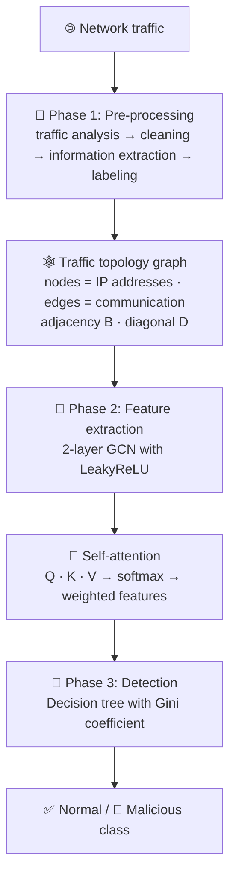

<div align="center">

# 🛡️ NetSentry — GSA-DT Network Intrusion Detection

**Malicious traffic detection with a Graph Self-Attention Network + Decision Tree (GSA-DT)**

[](https://netsentry-smart-network-intrusion-detection-nskb8eq7tk4lrqcrcq.streamlit.app/)


<br>


</div>

---

## 📖 About

**NetSentry** is a Streamlit web app that classifies network flows as normal or potentially malicious using **GSA-DT**, a model from
*Cai et al., "GSA-DT: A Malicious Traffic Detection Model Based on Graph Self-Attention Network and Decision Tree", IEEE TNSM 22(2), 2025.*

Traffic is modeled as a **graph of IP addresses**. A graph convolutional network learns how hosts relate to each other, self-attention highlights the features that matter, and a **Gini decision tree** makes the final, interpretable decision.

🔗 **Try it live:** https://netsentry-smart-network-intrusion-detection-nskb8eq7tk4lrqcrcq.streamlit.app/

---

## ✨ Features

- 📂 Upload **CSV, BINETFLOW, TXT, PCAP or PCAPNG** files (up to 200 MB per file)
- 🚨 Flags **normal vs potentially malicious** flows with a predicted class
- 📊 Shows a class breakdown of the uploaded traffic
- ⬇️ Download results
- ⚡ Runs on CPU, with no GPU needed

---

## 🏗️ Model Architecture

GSA-DT works in **three phases**: feature pre-processing, feature extraction, and malicious traffic detection.



### 1️⃣ Pre-processing and traffic topology

Traffic is analysed, cleaned and labeled. The source and destination IP addresses are then used to build a graph:

- **Adjacency matrix `B`**: `B[i][j] = 1` if node *i* and node *j* communicate, otherwise `0`
- **Diagonal matrix `D`**: `D[i][i]` = number of neighbours of node *i* plus 1 (the self-loop)
- **Normalized propagation matrix**:

$$S = D^{-1/2}\,(B + I)\,D^{-1/2}$$

### 2️⃣ Graph convolutional network (feature extraction)

Each GCN layer aggregates information from neighbouring hosts:

$$H^{(k)} = \sigma\left(S\,H^{(k-1)}\,\theta^{(k)}\right)$$

- The activation `σ` is **LeakyReLU**, which replaces ReLU. This fixes "dead neurons" and vanishing gradients and keeps a small gradient for negative inputs.
- The network has **2 layers**, with **16 hidden units** and **dropout 0.05**.

### 3️⃣ Self-attention

The GCN output is passed through a self-attention block. Query, key and value projections give attention weights:

$$\text{Attention}(Q,K,V) = \text{softmax}\!\left(\frac{QK^{T}}{\sqrt{d}}\right)V$$

Important features get larger weights and redundant ones are suppressed, which produces a stronger correlation feature `H'`.

### 4️⃣ Decision tree (detection)

The attention outputs of the source and destination nodes are classified by a **decision tree that splits on the Gini coefficient**:

$$\text{Gini}(D) = 1 - \sum_{i=1}^{C} p_i^{2}$$

The backbone (GCN + attention) is trained with **cross-entropy loss** for **10 epochs**. The tree is then fitted on the learned features, so the final decision stays **interpretable**.

| Component | Setting |
|---|---|
| Graph | Nodes = IP addresses, `S = D^-1/2 (B + I) D^-1/2` |
| GCN | 2 layers, hidden size 16, LeakyReLU |
| Regularization | Dropout 0.05 |
| Attention | Self-attention (Q / K / V) over the GCN features |
| Classifier | Decision tree, Gini criterion |
| Training | Cross-entropy, 10 epochs, 90 % / 10 % split |

---

## 📁 Repository Structure

```
.
├── app.py                                      # 🖥️ Streamlit inference interface
├── requirements.txt                            # 📦 Pinned Python dependencies
├── artifacts/                                  # 🧩 The eight trained model & preprocessing artifacts
├── docs/
│   └── app-screenshot.png                      # 🖼️ App screenshot used in this README
├── notebooks/                                  # 📓 Training & evaluation notebooks (run on Kaggle)
│   ├── majorproject-ustc.ipynb
│   ├── majorproject-ctusimilardataset.ipynb
│   └── majorproject-stratoshperesimilar.ipynb
└── README.md
```

### 🧩 Artifacts

`artifacts/` holds everything the app needs at inference time:

| # | Artifact | Role |
|:-:|---|---|
| 1 | GCN + self-attention weights | Learned graph / attention model |
| 2 | Decision tree | Final Gini classifier |
| 3 | Flow-feature scaler | Standardizes per-flow features |
| 4 | Node-feature scaler | Standardizes per-IP node features |
| 5 | Label encoder | Class ↔ id mapping |
| 6 | Graph state | Stored IP graph (adjacency + node statistics) |
| 7 | Configuration | Hyper-parameters and feature order |
| 8 | Label map | Human-readable class names |

---

## 🚀 Run Locally

```bash
# 1. Clone
git clone https://github.com/pavankumarchoudari/NetSentry-Smart-Network-Intrusion-Detection.git
cd NetSentry-Smart-Network-Intrusion-Detection

# 2. Install
pip install -r requirements.txt

# 3. Launch
streamlit run app.py
```

Then open **http://localhost:8501** 🎉

---

## 📥 Input Format

**Supported formats:** `CSV` · `BINETFLOW` · `TXT` · `PCAP` · `PCAPNG`

### Flow files (CSV / BINETFLOW / TXT)

The file must contain at least:

| Column | Required | Description |
|---|:---:|---|
| `SrcAddr` | ✅ | Source IP address |
| `DstAddr` | ✅ | Destination IP address |
| `Dur` | ➕ recommended | Flow duration |
| `TotPkts` | ➕ recommended | Total packets |
| `TotBytes` | ➕ recommended | Total bytes |
| `SrcBytes` | ➕ recommended | Bytes from source |
| `Sport` | ➕ recommended | Source port |
| `Dport` | ➕ recommended | Destination port |
| `Proto` | ➕ recommended | Protocol |
| `State` | ➕ recommended | Connection state |

For the closest match with the training notebooks, include all the recommended columns. Missing ones reduce fidelity.

### Packet captures (PCAP / PCAPNG)

Packet captures are converted to flows before classification. See the **"Input requirements and PCAP notes"** box inside the app for the details of how packets are turned into flow features.

---

## 📓 Notebooks & Datasets

Three notebooks, all run on Kaggle (copies are in [`notebooks/`](notebooks/)). Each uses a 90 % / 10 % split and the GSA-DT settings of hidden size 16, dropout 0.05 and 10 epochs.

| Notebook | Dataset | Classes | Kaggle |
|---|---|---|---|
| 🧪 **USTC** | USTC-TFC2016 raw pcaps converted to flows of at most 50 packets (243,505 flows) | 10 malware families (Cridex, Geodo, Htbot, Miuref, Neris, Nsis, Shifu, Tinba, Virut, Zeus) + Normal | [majorproject-ustc](https://www.kaggle.com/code/pavankumarchoudari/majorproject-ustc) |
| 🦠 **CTU-style** | Malware families rebuilt from public Stratosphere / CTU captures (244,516 flows) | Ursnif, Htbot, Tinba, Zeus, Artemis, Coinminer, Dridex, Miuref, Trickbot + Normal | [majorproject-ctusimilardataset](https://www.kaggle.com/code/pavankumarchoudari/majorproject-ctusimilardataset) |
| 🌐 **Stratosphere-style** | Malware families rebuilt from public Stratosphere captures, with Normal traffic from CTU-13 (75,082 flows) | Zeus, Miuref, Gookit, Dridex, Trickbot, Ursnif, Hancitor + Normal | [majorproject-stratoshperesimilar](https://www.kaggle.com/code/pavankumarchoudari/majorproject-stratoshperesimilar) |

---

## 📊 Results

All numbers are **mean ± std over 10 random 90/10 splits**, taken from the notebooks above.
**Accuracy** is multi-class accuracy over all classes. **TPR / FPR / F1** are attack-vs-Normal.

### 🧪 USTC-TFC2016 (11 classes)

| Model | Accuracy | Macro-F1 | TPR | FPR | F1 |
|---|:---:|:---:|:---:|:---:|:---:|
| **GSA-DT** | **97.71 ± 0.09** | **98.58 ± 0.06** | 100.00 ± 0.00 | 0.00 ± 0.00 | 100.00 ± 0.00 |
| XGBoost (flow features) | 97.63 ± 0.09 | 98.49 ± 0.06 | 100.00 ± 0.00 | 0.00 ± 0.00 | 100.00 ± 0.00 |
| Decision tree (flow features) | 97.22 ± 0.15 | 98.15 ± 0.11 | 100.00 ± 0.00 | 0.00 ± 0.00 | 100.00 ± 0.00 |
| GCN (ReLU) + linear | 95.15 ± 0.40 | 96.77 ± 0.36 | 100.00 ± 0.00 | 0.43 ± 1.25 | 99.96 ± 0.12 |
| TCN (simplified) | 94.39 ± 0.38 | 95.24 ± 0.33 | 99.98 ± 0.01 | 0.07 ± 0.05 | 99.98 ± 0.01 |

- 🔍 Most remaining errors are **Neris ↔ Virut** confusions, plus Nsis flows predicted as Neris or Virut.
- 🧮 GSA-DT performs on par with the flow-feature XGBoost baseline on this dataset.

### 🦠 CTU-style dataset (10 classes)

| Model | Accuracy | Macro-F1 | TPR | FPR | F1 |
|---|:---:|:---:|:---:|:---:|:---:|
| **GSA-DT** | **95.00 ± 0.10** | 93.66 ± 0.14 | 99.93 ± 0.02 | 1.55 ± 0.20 | 99.82 ± 0.01 |

- 🔍 The weakest classes are **Zeus, Coinminer and Tinba**.
- 📉 Torgan could not be recovered from public captures, and Ursnif is only partly covered, so the dataset is smaller than intended (244,516 of 264,541 flows).

### 🌐 Stratosphere-style dataset (8 classes)

| Model | Accuracy | Macro-F1 | TPR | FPR | F1 |
|---|:---:|:---:|:---:|:---:|:---:|
| **GSA-DT** | **99.12 ± 0.08** | 98.56 ± 0.15 | 100.00 ± 0.01 | 0.03 ± 0.03 | 99.99 ± 0.01 |

- 🔍 The weakest class is **Gookit** (about 94 % recall in a single run); the other classes are at 98 % or better.
- 📉 This dataset is much smaller than intended (75,082 of 216,530 flows). Dreambot could not be found, Gookit, Hancitor and Ursnif have only 41–50 % of their intended flows, and Normal has 14 % of its intended size. The result is for this smaller, easier dataset.

### 📚 For reference: original GSA-DT paper

| Dataset | Accuracy | TPR | FPR | F1 |
|---|:---:|:---:|:---:|:---:|
| USTC-TFC2016 | 99.96 | 99.98 | 0.04 | 99.96 |
| CTU | 99.36 | 99.70 | 0.32 | 99.67 |
| Stratosphere | 98.49 | 97.82 | 1.64 | 97.65 |

> 📝 The paper releases no code and does not specify how flows were built or which captures were used, so the datasets here are reconstructions and the numbers are not directly comparable.

---

## ⚠️ Limitations

- 🕸️ **It's a graph model.** A flow is classified from its source and destination IP nodes, so results depend on the stored IP graph. Unseen IPs become new nodes with features taken only from the uploaded flows.
- 🧍 **Host identity.** Each class comes from one or a few captures with few hosts, so part of the accuracy can reflect which hosts appear rather than detection skill.
- 🌐 **Domain shift.** The model learned the hosts and attack families of its training data. Expect lower accuracy on unrelated networks.
- 🔐 **Pickle files.** Only load model artifacts from sources you trust, and keep the pinned library versions.
- 🎓 This is a **research / educational project**, not a production IDS.

---

## 🗺️ Roadmap

- [ ] 📈 Per-class metrics and confusion matrix inside the app
- [ ] 🔍 Show the decision-tree path for each flagged flow
- [ ] 🧪 Validate PCAP flow extraction against the notebooks' feature definitions on more captures
- [ ] 🐳 Docker image

---

## 📚 Reference

Cai et al., **"GSA-DT: A Malicious Traffic Detection Model Based on Graph Self-Attention Network and Decision Tree,"** *IEEE Transactions on Network and Service Management*, vol. 22, no. 2, 2025.

---

## 👤 Author

**PAVANKUMAR CHOUDARI**

<div align="center">

⭐ If you found this useful, consider starring the repo!

</div>
